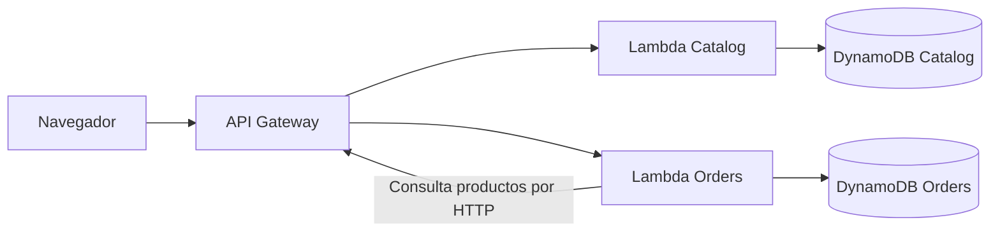

# Campus Café

Campus Café es una aplicación de pedidos para una cafetería. Está hecha con Python, FastAPI y AWS. La página web permite ver el menú, crear pedidos, consultar pedidos anteriores y cancelarlos.

## Cómo está organizada



- **Catalog** guarda y entrega los productos.
- **Orders** crea, consulta y cancela pedidos. Para validar un producto, consulta a Catalog por HTTP.
- Cada servicio tiene su propia tabla DynamoDB. Orders no lee directamente la tabla de Catalog.
- API Gateway recibe las solicitudes y las envía a la función Lambda correspondiente.

### Dos decisiones importantes

**Separar los servicios y sus datos.** Catalog es responsable del menú y Orders de los pedidos. Si Orders necesita información de un producto, la obtiene mediante la API de Catalog. Así, cada servicio controla sus propios datos.

**Guardar el pedido y la clave de idempotencia juntos.** Al crear un pedido, Orders guarda en una transacción de DynamoDB tanto el pedido como la clave usada para crearlo. Si se repite la misma solicitud, devuelve el pedido original. Si se usa la misma clave con datos distintos, responde con un conflicto `409`. Esto evita pedidos duplicados, incluso si llegan varias solicitudes al mismo tiempo.

## Qué necesitas

- Python 3.14 y [`uv`](https://docs.astral.sh/uv/).
- AWS CLI y AWS SAM CLI.
- Un perfil de AWS con acceso al entorno del curso, en la región `us-east-1`.
- Git.

La plantilla SAM configura las funciones con el runtime `python3.14`. La aplicación se desplegó en `us-east-1`; la evidencia del despliegue está en `evidence/deployed-acceptance.json`.

Comprueba tus herramientas y la cuenta antes de desplegar:

```powershell
python --version
uv --version
aws --version
sam --version
aws sts get-caller-identity
```

## Preparar y ejecutar en tu equipo

Instala las dependencias y ejecuta las pruebas incluidas:

```powershell
uv sync --all-groups
uv run pytest
uv run ruff check
```

La aplicación local usa datos en memoria. No necesita credenciales AWS, pero los pedidos se pierden al detenerla. Sirve para probar la página y las reglas de negocio; no demuestra que DynamoDB haya guardado los datos.

Abre una terminal y ejecuta las API locales:

```powershell
uv run python scripts/local_api.py
```

En otra terminal, inicia la página:

```powershell
uv run python -m http.server 4173 --directory frontend
```

Abre <http://localhost:4173/?api=http://127.0.0.1:8002>. La documentación local de la API está en <http://127.0.0.1:8002/docs>.

## Desplegar en AWS

Desde la carpeta del proyecto, instala dependencias si aún no lo has hecho. Después, exporta las dependencias que SAM incluirá en las funciones y prepara el despliegue:

```powershell
uv export --no-dev --no-emit-project --format requirements-txt --output-file src/requirements.txt
sam validate --lint
sam build --beta-features
sam deploy --guided
```

En las preguntas de SAM, usa la cuenta y región autorizadas por el curso. La configuración guardada en `samconfig.toml` sugiere `us-east-1`. Antes de confirmar, revisa el nombre de la pila, el rol y los recursos que se crearán.

Al terminar, SAM muestra varios valores. Anota `ApiBaseUrl`, `CatalogTableName` y `OrdersTableName`; los necesitarás en los siguientes pasos.

### Limitación del rol de ejecución

La tarea pide dos roles separados con permisos mínimos: uno para Catalog y otro para Orders. En esta cuenta no tenemos permiso para crear roles IAM. El intento desde la CLI y desde la consola fue rechazado con `AccessDenied` para `iam:CreateRole`. Por eso las dos funciones usan el rol compartido `LabRole`.

Esto permitió desplegar y ejecutar la aplicación, pero **no cumple el requisito de roles separados ni limita el acceso de cada función a su propia tabla**. El resultado del intento denegado está en `evidence/iam-role-attempt.json`. Para completar ese requisito, el administrador del curso tendría que crear y autorizar los roles correspondientes.

### Conectar Orders con Catalog

La primera creación de la pila no conoce todavía la URL que generará API Gateway. Cuando SAM termine, actualiza la pila usando el valor real de `ApiBaseUrl`:

```powershell
sam deploy --no-confirm-changeset --parameter-overrides FrontendOrigin=http://localhost:4173 CatalogTimeoutSeconds=5 CatalogApiBaseUrl=<ApiBaseUrl> LambdaExecutionRoleName=LabRole
```

Reemplaza `<ApiBaseUrl>` por la URL que SAM mostró. Esta actualización configura a Orders para consultar el menú desplegado.

### Cargar el menú y abrir la página desplegada

Carga los productos en la tabla cuyo nombre mostró SAM:

```powershell
uv run python scripts/seed_catalog.py --table <CatalogTableName> --region us-east-1
```

El comando se puede repetir; carga los mismos seis productos. Para que la página consulte esta API, usa esta dirección en el navegador:

```text
http://localhost:4173/?api=<ApiBaseUrl>
```

Usa el mismo servidor web del apartado anterior. Si ya está abierto, no necesitas iniciarlo de nuevo.

## Comprobar la API desplegada

Ejecuta el script de aceptación después de desplegar y cargar el menú:

```powershell
uv run python scripts/acceptance.py --api-url <ApiBaseUrl> --orders-table <OrdersTableName> --region us-east-1
```

El script comprueba el menú, los productos inexistentes y no disponibles, los precios, la creación y repetición de pedidos, los conflictos de clave, las lecturas, las cancelaciones y cinco solicitudes concurrentes. También comprueba en DynamoDB que la solicitud concurrente dejó un solo pedido y su registro de idempotencia. Al final mide 20 lecturas y muestra su p95: el tiempo que no superó el 95 % de esas lecturas.

## Resultados y evidencia

Estas pruebas se ejecutaron contra la API desplegada en `us-east-1`. Cada resultado apunta al archivo que contiene su evidencia.

| Resultado | Evidencia y qué muestra |
| --- | --- |
| Aceptación desplegada: `PASS` | [deployed-acceptance-current.json](evidence/deployed-acceptance-current.json) es la salida guardada de `scripts/acceptance.py`. La tabla incluye el estado, las mediciones y las cinco respuestas concurrentes. |
| Seis productos en Catalog | [current-aws-state.json](evidence/current-aws-state.json) guarda el conteo devuelto por una lectura de DynamoDB y el estado actual de la pila. |
| Rendimiento | La corrida más reciente midió **123,9 ms de p95** en 20 lecturas; su primera consulta al menú tardó **468,24 ms**. Ambos valores están en la salida del script enlazada arriba. |
| Inicio en frío de la corrida anterior | [cold-start-verification.json](evidence/cold-start-verification.json) reúne la medición anterior de **4.569,22 ms** y los eventos de CloudWatch de esa misma llamada: `INIT_START` y `Init Duration: 1871.30 ms`. Eso sí confirma un inicio en frío para aquella llamada. El valor p95 de esa corrida (**140,02 ms**) está en [deployed-acceptance.json](evidence/deployed-acceptance.json); la medición más reciente es 123,9 ms. |
| Cinco solicitudes concurrentes | La salida de aceptación muestra un `201`, cuatro `200` y un solo ID. [dynamodb-concurrency-verification.json](evidence/dynamodb-concurrency-verification.json) contiene la lectura consistente del pedido y del registro de idempotencia asociados a ese ID. |
| Pedido repetido tras actualizar configuración | [configuration-update-replay.json](evidence/configuration-update-replay.json) guarda los eventos de CloudWatch: creación `201`, repetición `200` y consulta `200`, con el mismo ID. También contiene la lectura de DynamoDB y la revisión `2` de la pila. El cambio de revisión `1` a `2` está registrado en [deployed-acceptance.json](evidence/deployed-acceptance.json). |
| Fallo de Catalog | [catalog-failure-isolation-run.json](evidence/catalog-failure-isolation-run.json) contiene la solicitud real, respuesta `503`, ambos eventos de CloudWatch, la lectura consistente de DynamoDB sin registro de idempotencia y la URL válida restaurada. |
| Registro correlacionado | [correlated-cloudwatch-logs.json](evidence/correlated-cloudwatch-logs.json) guarda el evento original de API Gateway y el de Orders Lambda. Ambos llevan el mismo `requestId` y registran la creación del pedido con `201`. |
| Cancelación repetida | [cancellation-double-verification.json](evidence/cancellation-double-verification.json) guarda las dos respuestas `200` de cancelación y la lectura consistente de DynamoDB, cuyo estado final es `CANCELLED`. |

Ejemplo real de los dos registros de una misma solicitud. El texto completo de ambos eventos está en `evidence/correlated-cloudwatch-logs.json`:

```text
API Gateway, 2026-10-26 16:17:11.554 UTC:
{"requestId":"F3B5QjjaIAMEJDA=","routeKey":"POST /orders","status":"201","responseLength":"262","requestTime":"26/Oct/2026:16:17:11 +0000"}

Orders Lambda, 2026-10-26 16:17:17.026 UTC:
[INFO] 2026-10-26T16:17:17.026Z 338d9d30-9ca8-4190-b1d5-714e99a184d3 {"requestId":"F3B5QjjaIAMEJDA=","operation":"orders","method":"POST","path":"/orders","result":201,"durationMs":2398.13,"orderId":"315401f1-4ea5-4daa-9e3f-8fbb28dea079"}
```

Las pruebas unitarias están en `tests/`, pero no hay una salida guardada de `pytest`, Ruff, `sam validate` ni `sam build`. No los presento como resultados verificados.

Esta es una muestra de esos mensajes reales. El archivo enlazado arriba conserva los eventos que AWS devolvió:

```text
API Gateway, 2026-10-26 16:17:11.554 UTC:
{"requestId":"F3B5QjjaIAMEJDA=","routeKey":"POST /orders","status":"201","responseLength":"262","requestTime":"26/Oct/2026:16:17:11 +0000"}

Orders Lambda, 2026-10-26 16:17:17.026 UTC:
[INFO] 2026-10-26T16:17:17.026Z 338d9d30-9ca8-4190-b1d5-714e99a184d3 {"requestId":"F3B5QjjaIAMEJDA=","operation":"orders","method":"POST","path":"/orders","result":201,"durationMs":2398.13,"orderId":"315401f1-4ea5-4daa-9e3f-8fbb28dea079"}
```

## Eliminar los recursos

Las tablas tienen una regla que las conserva cuando se elimina la pila. Guarda sus nombres antes de borrar:

```powershell
sam delete --stack-name campus-cafe --region us-east-1
```

Si el instructor pide borrar también los datos, elimina las tablas retenidas después de borrar la pila:

```powershell
aws dynamodb delete-table --table-name <CatalogTableName> --region us-east-1
aws dynamodb delete-table --table-name <OrdersTableName> --region us-east-1
```

